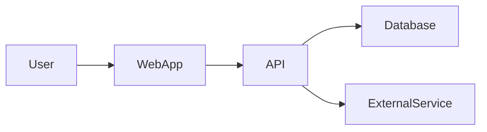

# Codebase Reacclimation

Use this skill when a developer returns to a project after time away or needs a clear map of how the system works. The goal is understanding, not refactoring. Do not modify application code unless the user explicitly asks.

## Core principles

- Start from the repository's actual entry points and runtime behavior, not folder names alone.
- Follow one or two important user journeys end to end: UI -> client/API -> backend -> data store or external service -> response -> UI.
- Distinguish facts observed in code from reasonable inferences. Mark uncertainty explicitly.
- Prefer a small number of useful diagrams over exhaustive inventories.
- Cite paths, symbols, commands, and configuration keys so the developer can verify every conclusion.
- Never print or reproduce secret values. Report secret names and where they are consumed only.
- Treat documentation as a maintained product artifact: update it from code evidence, preserve useful existing content, and record unknowns instead of inventing answers.

## Documentation and diagram artifacts

Unless the repository already has a documentation convention, use this layout:

- `README.md` — the concise project entry point plus a link to the architecture guide.
- `docs/architecture.md` — the detailed, reusable reacclimation and system-design document.
- `docs/architecture/` — editable Excalidraw sources and rendered PNGs, for example:
  - `system-overview.excalidraw` / `system-overview.png`
  - `request-flow.excalidraw` / `request-flow.png`
  - `deployment.excalidraw` / `deployment.png`

Do not replace a project's existing README wholesale. Merge in or refresh the relevant sections, preserve project-specific instructions, and link to `docs/architecture.md`. If the repository has another docs layout, follow it.

Use the installed Excalidraw CLI to render local source files:

```sh
excalidraw render docs/architecture/system-overview.excalidraw \
  --out docs/architecture/system-overview.png
```

Keep `.excalidraw` source files checked in beside their PNGs so diagrams can be edited and regenerated. Prefer a small set of diagrams that answer different questions rather than one unreadable mega-diagram. Reference each PNG from Markdown with a relative image link and include a one-sentence explanation. If the CLI is unavailable or a source file cannot be rendered, say so clearly and do not claim the PNG is current.

## Workflow

### 1. Establish scope

Ask, or infer from the request:

- Which repository and branch should be inspected?
- Is the goal a quick refresher or a deep architecture map?
- Which product flows matter most?
- Should the output be written to a repository document, or returned only in chat?

If no scope is provided, inspect the whole repository but prioritize production code, configuration, tests, infrastructure, and documentation. Exclude generated files, dependencies, build output, caches, and large assets.

### 2. Inventory the system

Inspect in this order:

1. Root files: README, package/build manifests, workspace files, Docker/compose files, CI workflows, environment examples, and infrastructure definitions.
2. Application entry points: frontend bootstrapping, server startup, workers, scripts, and CLI commands.
3. Top-level source directories and module boundaries.
4. Route definitions, controllers/handlers, services/use cases, repositories/ORM models, schemas, and middleware.
5. Frontend routes/pages, layouts, state management, API clients, hooks, forms, and shared components.
6. Tests and fixtures to learn intended behavior.
7. Deployment, observability, queues, scheduled jobs, caches, storage, and third-party integrations.

Use repository search and targeted file reads. Do not claim a component exists solely because its directory name suggests it does.

### 3. Build the maps

Create these maps from evidence:

#### Repository map

- Applications, packages, and shared libraries
- Responsibilities of each major directory
- Build and run commands
- Test locations and test strategy
- Generated or external code that should not be edited

#### Frontend map

- App entry point and route tree
- Page-to-component relationships
- State ownership and data-fetching approach
- API/client boundaries and error/loading behavior
- Authentication, authorization, and protected routes
- Important shared UI primitives and design-system boundaries

#### Backend map

- Process entry points and server framework
- Request lifecycle: middleware -> routing -> validation -> handler -> service -> persistence
- Domain modules and their dependencies
- Authentication and authorization enforcement points
- Background workers, jobs, events, and scheduled tasks
- Error handling, logging, metrics, and health checks

#### Data and integration map

- Databases, schemas/models, migrations, and repositories
- Cache, object storage, queues, and event buses
- External APIs, webhooks, email, payments, analytics, and identity providers
- Ownership of data and important consistency or retry behavior

#### System-design map

- Runtime/deployment topology
- Trust boundaries and network boundaries
- Synchronous and asynchronous flows
- Main scaling, reliability, and security characteristics
- Configuration and secrets flow
- Single points of failure and operational dependencies

### 4. Trace representative flows

Trace at least one read flow and one write or authenticated flow when the repository supports them. For each flow record:

- User action or trigger
- Frontend entry point
- Network request and endpoint
- Backend route and middleware
- Service/domain logic
- Data stores or external systems touched
- Response, state update, and UI outcome
- Validation, authorization, retries, and failure paths

If a flow cannot be traced, say exactly where the evidence stops.

### 5. Create or update the project documentation

The normal deliverable is a documentation update, not only a chat response:

1. Read the existing `README.md`, architecture docs, and diagram sources first.
2. Create or update `docs/architecture.md` with the full reacclimation report below.
3. Add or refresh the architecture PNGs and their editable `.excalidraw` sources.
4. Add a concise `Architecture` or `Reacclimation` section to `README.md` linking to the detailed guide and showing the most useful overview PNG.
5. Preserve manual sections that are still accurate; mark stale sections for review rather than silently deleting them.
6. Include an `Architecture document status` line with the date, inspected branch/commit, and whether diagrams were regenerated.

When updating existing docs, show what changed in the final response and identify any content that could not be verified.

### 6. Report structure

Use this structure in `docs/architecture.md`:

# Codebase Reacclimation: <project>

## Executive summary

- What the system does
- Architecture style and major technologies
- Main runtime components
- Most important thing to remember

## How to run it

- Prerequisites
- Install/build/test/dev commands found in the repository
- Required services and environment variables by name only
- Known setup traps

## Repository map

A concise tree of meaningful directories with responsibilities and links to key files.

## Architecture overview

Explain the system in plain language, then include a Mermaid diagram such as:



Use only relationships supported by the code. Label inferred relationships as `inferred`.

## Frontend

Route map, component boundaries, state/data flow, authentication, and the most important files.

## Backend

Process startup, request lifecycle, domain modules, persistence, background work, and operational behavior.

## Key end-to-end flows

Provide the traced read and write/authenticated flows with file and symbol references.

## Data model and integrations

List important entities, relationships, stores, external systems, and ownership boundaries.

## Configuration and deployment

Explain environments, build/deploy path, runtime processes, secrets by name, and infrastructure.

## Risks, unknowns, and stale-looking areas

Separate:

- Confirmed risks or broken paths
- Suspected technical debt
- Questions requiring runtime validation
- Areas with weak or missing tests/documentation

Do not turn suspicions into facts.

## Best next reading order

Give a short sequence of files or modules that will restore working context fastest.

## Glossary

Define project-specific terms, abbreviations, and important domain concepts.

### 7. Keep documentation synchronized

When this skill is run after code changes, treat the current docs as a starting point, not as truth. Compare changed files and recent commits against the architecture guide and update only affected sections and diagrams. At minimum check:

- New, removed, or renamed entry points and routes
- Frontend/backend API contract changes
- New data stores, entities, queues, jobs, or integrations
- Authentication, authorization, deployment, and configuration changes
- Changes to the main traced user flows

Use the repository's existing commit history when useful to explain why a boundary exists. Do not rewrite diagrams merely for cosmetic consistency.

### 8. Validate the map and artifacts

Before finishing:

- Check that every named entry point, route, service, and store exists.
- Compare documentation with implementation and call out contradictions.
- Prefer test references or call sites over comments when they disagree.
- Run safe inspection commands or existing tests only when useful and permitted.
- Do not start services, migrate data, send requests to production, or alter state without explicit approval.

## Output quality bar

A good result lets the returning developer answer:

1. What runs, where does it start, and how is it deployed?
2. What happens when a user performs the main action?
3. Where do frontend, backend, database, and external services connect?
4. Where are authentication, validation, errors, and retries handled?
5. Which files should be read first to make a safe change?

Keep the report navigable. Favor high-value paths and relationships over listing every file.
